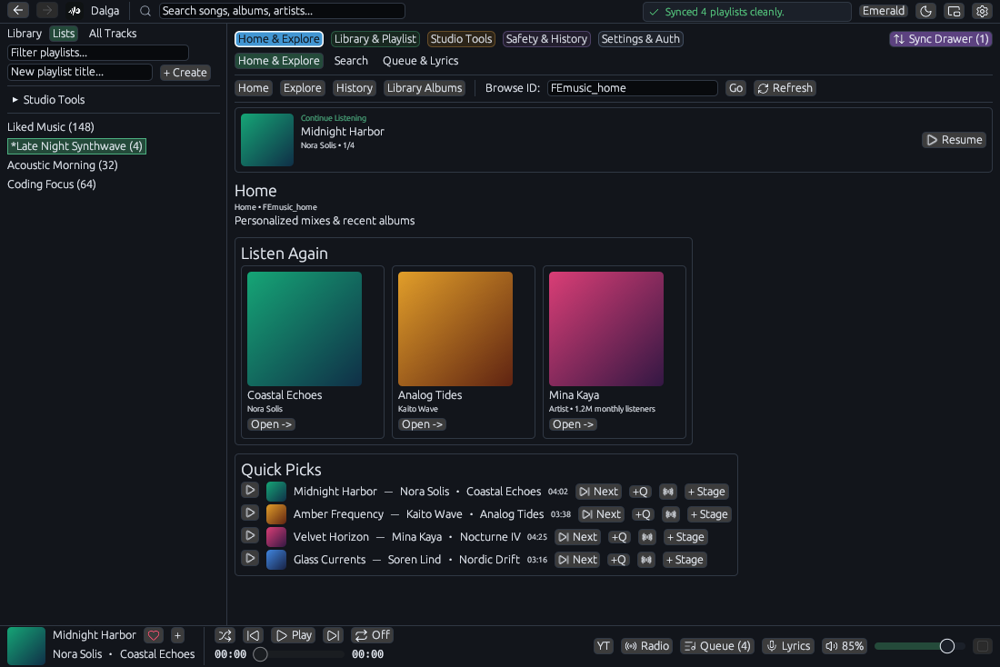
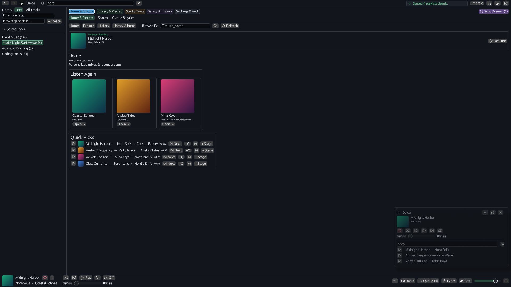
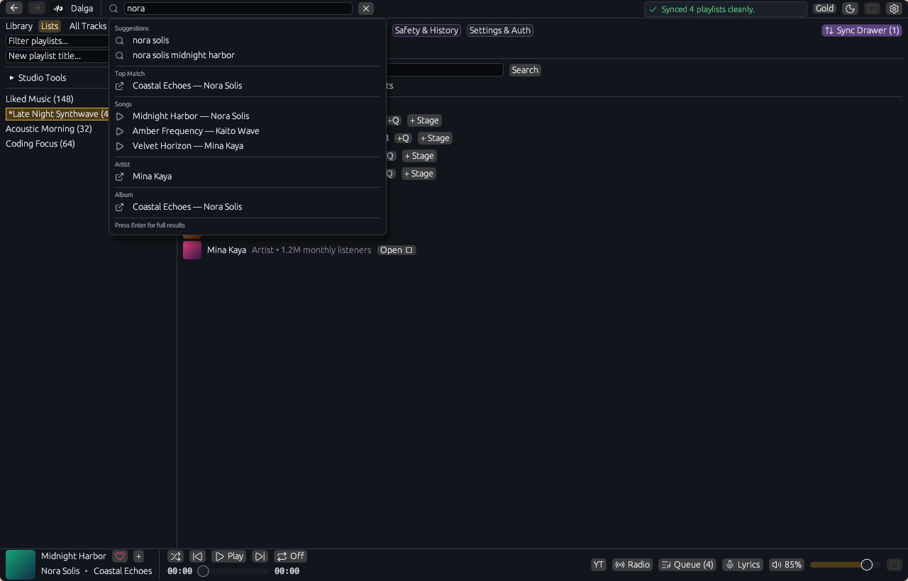
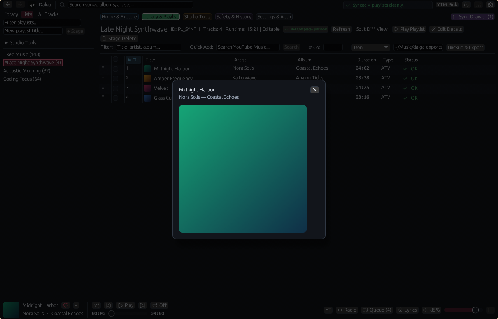
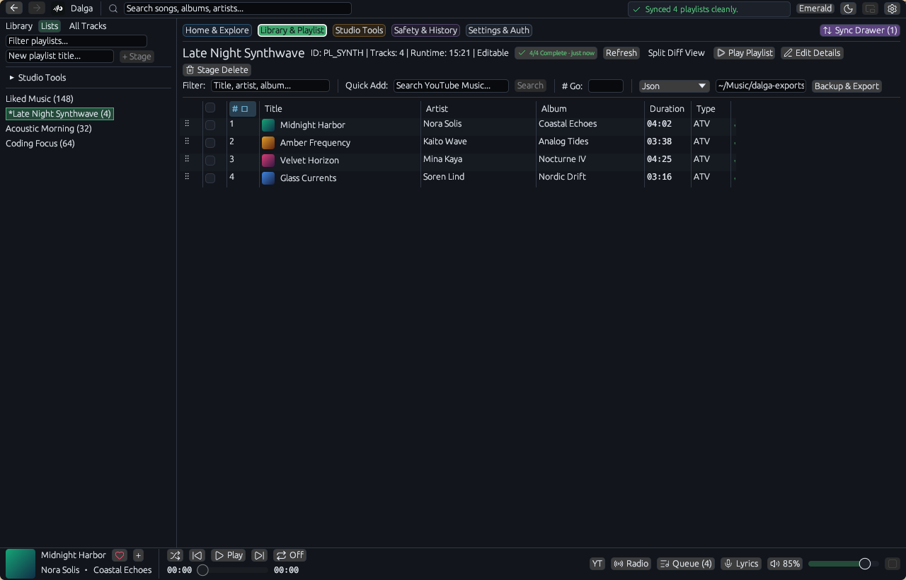
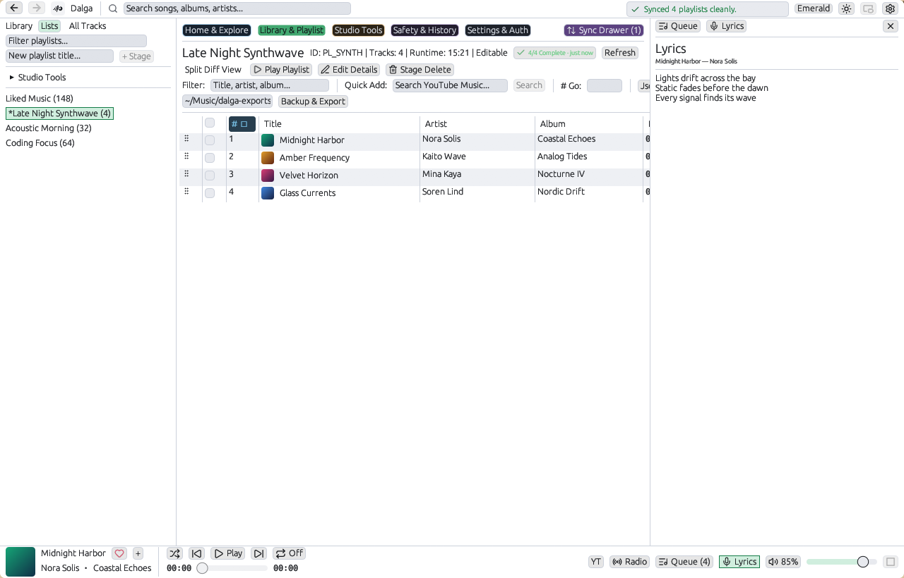

<p align="center">
  <picture>
    <source media="(prefers-color-scheme: dark)" srcset="assets/brand/dalga-wordmark-dark.svg" width="420">
    <source media="(prefers-color-scheme: light)" srcset="assets/brand/dalga-wordmark-light.svg" width="420">
    
  </picture>
</p>

<p align="center">
  <strong>Dalga</strong> — Local-first, pure-Rust YouTube Music desktop player &amp; playlist studio (<code>ytm-gui</code> + <code>ytm</code>) for Linux &amp; Windows.
</p>

<p align="center">
  <a href="https://github.com/waldseelen/YTMUSICFY/releases"></a>
  <a href="LICENSE-MIT"></a>
  
  
</p>

Instead of wrapping YouTube Music in Electron or a heavy browser process, **Dalga** speaks YouTube Music's own **InnerTube HTTP API** directly using your local browser session (`SAPISIDHASH` + `Cookie`), streams audio through a lightweight **headless `mpv` IPC backend**, and locks every remote edit behind a strict **`Configure -> Preview -> Verified POST`** pipeline with automatic SQLite snapshots.

---

<p align="center">
  
</p>

---

## Why Dalga?

- **Zero Electron / WebView Overhead:** Native `eframe`/`egui` desktop studio (`ytm-gui`), terminal dashboard (`ytm tui`), and scriptable CLI (`ytm`).
- **Offline-First Resilience:** SQLite-backed library, playlists, Home shelves, and lyrics cache (`schema v4`) hydrate instantly on launch and remain browsable even when your network or session goes offline.
- **No Unattended Background Scraping:** Uses your existing YouTube Music browser cookies explicitly on demand—plus a one-click **Refresh Session** flow that opens YouTube Music and imports the renewed session once ready.
- **Safety-Locked Playlist Engineering:** `FetchManifest` completeness checks, `PlanFingerprint` staleness guards, chunked verified writes, SQLite pre-mutation snapshots with restore diffs, and `StrictLock` / `QuickLike` controls.

---

## What's Inside Dalga (`v0.4.0`)

| Area | Highlights |
| :--- | :--- |
| **All of Artist & Discovery** | Recursive artist discography harvester (albums, singles, appears-on + continuations) with ATV-over-UGC dedupe and snapshot-guarded playlist apply, plus **Similar Songs** / Radio from any target and opt-in **Last.fm** scrobbling. |
| **Audio FX & Quick-Add** | mpv `af=equalizer` chains (**Flat**, **Bass Boost**, **Vocal**, Custom 5/10-band), pitch-corrected **0.75x–1.5x** playback speed, injected-clock **Sleep Timer** with fade-out, and one-click player-bar **Quick-Add** to a favourite playlist. |
| **History, Notifications & A11y** | SQLite **Recently Played** history (capped at 500 entries), opt-in desktop notifications (`notify-send` on Linux, off by default), **Font Scale** (`0.8x–2.0x`), **High-Contrast** WCAG-AA palette, visible focus rings, and AccessKit-ready `Icon` tooltips. |
| **System Tray & Close-to-Tray** | Theme-aware system tray (`ksni` StatusNotifierItem on Linux, Win32 `tray-icon` on Windows) with Show/Hide, Play/Pause, Next, Previous, Mini Player, and Quit; closing the main window minimizes to tray while playback continues. |
| **Borderless Mini Player** | Always-on-top secondary viewport (`Ctrl+M`) with Compact & Expanded live search modes, Spotify-style edge snapping, per-monitor layout persistence, corner resize handle, and optional idle opacity dimming. |
| **Home Shelves & Continue Card** | Personalized Home shelves (`Listen Again`, `Mixed for you`, `New releases`, `Quick picks`) with horizontal shelf scroll, skeleton loading, a **Continue Listening** card from your saved playback session, and SQLite `browse_cache` offline hydration. |
| **Unified Context Menu & Shortcuts** | Consistent right-click `ContextTarget` menu across Home, Browse, Search, Queue, and Inspector, paired with a central `SHORTCUTS` registry (`/`, `Ctrl+M`, `Ctrl+K`, media keys) rendered live in Settings. |
| **Brand & Vector Iconography** | 53 crisp monochrome Lucide SVG icons rendered cleanly on all HiDPI scales; zero emoji/glyph drift across buttons and drawers. |
| **Adaptive Theme Engine** | **Ultra-Dark** and **Apple-style Light** themes following OS preference (`System` / `Dark` / `Light`), paired with **Emerald**, **Gold**, and **YTM Pink** accents plus optional off-thread **Dynamic Album Art Accent** (`WCAG AA >= 4.5:1` verified). |
| **Bilingual UI (EN & TR)** | Instant Turkish/English interface (`System` locale detection or explicit `EN`/`TR` switcher) across bars, drawers, playback, and settings. |
| **Unified Chrome & Status Ribbon** | Top bar with Back/Forward history, centered search, interactive **Status Ribbon** ticker (error/staged/hint/greeting priority + 50-item history popup + click-to-undo/Sync), and collapsible **Studio Tools** sidebar. |
| **Typeahead Instant Search** | Debounced InnerTube autocomplete + live categorized dropdown (`Top Match`, `Songs`, `Artist`, `Album`) with full keyboard navigation (`Up`/`Down`/`Enter`/`Esc`) and 12-item recent history. |
| **Playback, Drawers & Lightbox** | Headless `mpv` IPC with 15s prefetch, MPRIS2/SMTC OS media controls, independent right-hand **Queue** & **Lyrics** drawers, and click-to-zoom **Album Artwork Lightbox**. |
| **Playlist Studio (`ytm` + GUI)** | Exact/fuzzy **Dedupe**, `O(N log N)` LIS minimal-move **Sort**, **Set Algebra** (`diff`, `intersect`, `merge`), **Health** (`UGC -> Official ATV` upgrade), **Genre Split**, and **Snapshots**. |

### Mini Player (Compact & Expanded Search)

<p align="center">
  
</p>

### Instant Search & Album Lightbox

| Top-Bar Typeahead Dropdown | Album Artwork Lightbox |
| :---: | :---: |
|  |  |

### Ultra-Dark vs. Light Theme

| Ultra-Dark (`ThemeMode::Dark`) | Light (`ThemeMode::Light` + Lyrics Drawer) |
| :---: | :---: |
|  |  |

---

## Download Pre-Built Releases (Linux & Windows)

Pre-built archives and checksums are published on [**GitHub Releases**](https://github.com/waldseelen/YTMUSICFY/releases).  
*(Release archive and crate identifiers preserve `ytm-architect` / `ytm` / `ytm-gui` for seamless `v0.1.x` config compatibility.)*

| Platform | Target | Archive | Binaries Included |
| :--- | :--- | :--- | :--- |
| **Linux (x86_64)** | `x86_64-unknown-linux-gnu` | `ytm-architect-v0.4.0-linux-x86_64.tar.gz` | `ytm-gui`, `ytm` |
| **Windows (x86_64)** | `x86_64-pc-windows-msvc` | `ytm-architect-v0.4.0-windows-x86_64.zip` | `ytm-gui.exe`, `ytm.exe` |

### Verify Checksums (`SHA256SUMS.txt` — `v0.4.0`)

| Artifact | SHA-256 |
| :--- | :--- |
| `ytm-architect-v0.4.0-linux-x86_64.tar.gz` | `573c75b540d5690b3a972933e894788c55f8775b6f99bbf3cf8f3dacefb81287` |
| `ytm` (Linux x86_64) | `b08f651f374973af368b2de3bb9b4a2e00fcad1cc7fcdbe7a68d87798b963fed` |
| `ytm-gui` (Linux x86_64) | `334ebe237b47b0975a441d4423399f93f09ffa858315eaa3445d751c56a924b1` |
| `ytm-architect-v0.4.0-windows-x86_64.zip` | `8eb607b577810ebf24f9054478d7c438103168d8e514220b33ab01ed7937df7f` |
| `ytm.exe` (Windows x86_64) | `9f6515ccd9b0b11d81b8d0354cfa59867e792748e19dcec1626b03552f3a0b7b` |
| `ytm-gui.exe` (Windows x86_64) | `7909904d30774611e5f45ed094cf9f4c449b62608cd229d0594721e442dd416b` |

#### Linux
```bash
tar -xzf ytm-architect-v0.4.0-linux-x86_64.tar.gz
sha256sum -c SHA256SUMS.txt --ignore-missing
./ytm-architect-v0.4.0-linux-x86_64/ytm-gui
```

#### Windows (PowerShell)
```powershell
Expand-Archive .\ytm-architect-v0.4.0-windows-x86_64.zip -DestinationPath .\dalga
Get-FileHash .\dalga\ytm-architect-v0.4.0-windows-x86_64\ytm-gui.exe -Algorithm SHA256
.\dalga\ytm-architect-v0.4.0-windows-x86_64\ytm-gui.exe
```

> **Audio Playback Prerequisites:** Install [`mpv`](https://mpv.io/) and [`yt-dlp`](https://github.com/yt-dlp/yt-dlp) on `PATH` for audio streaming in `ytm-gui`. Library inspection, offline browsing, search, dedupe, sorting, set algebra, exports, and verified sync work standalone without external binaries.

---

## Build From Source

Requires **Rust 1.85+** (Edition 2024).

### Linux
```bash
# Arch / Omarchy / Debian / Ubuntu build deps: dbus, xkbcommon, gtk3, openssl, sqlite
cargo build --release --locked --bin ytm-gui --bin ytm
./target/release/ytm-gui
```

### Windows (PowerShell)
```powershell
cargo build --release --locked --bin ytm-gui --bin ytm
.\target\release\ytm-gui.exe
```

### Linux (Hyprland Floating Rule for Mini Player)
Add a floating rule to your Hyprland config so `Dalga Mini` opens as a compact floating overlay rather than tiling:
```ini
windowrulev2 = float, title:^(Dalga Mini)$
```

---

## Keyboard Shortcuts

| Shortcut | Action |
| :--- | :--- |
| `Ctrl+1` .. `Ctrl+5` | Switch primary workspaces (`Home`, `Library`, `Studio`, `Safety`, `Settings`) |
| `/` or `Ctrl+F` | Focus top-bar instant search (`/` active when not typing) |
| `Ctrl+M` | Toggle always-on-top Mini Player |
| `Ctrl+K` | Open Command Palette |
| `Ctrl+Shift+S` | Toggle Sync Staging Drawer |
| `Ctrl+Z` / `Ctrl+Shift+Z` | Undo / Redo staged playlist mutation |
| `Ctrl+Enter` | Execute staged mutations (verified POST + snapshot) |
| `Ctrl+O` / `Ctrl+Shift+O` | Open current track on YouTube Music (at start / current second) |
| `Space` / `M` | Play/Pause / Mute |
| `Alt+Left` / `Alt+Right` | Navigate Back / Forward history |

---

## Authentication & Session Refresh

1. Sign in to `https://music.youtube.com` in Chrome, Brave, Edge, or Firefox.
2. When an existing session expires, click **Refresh Session** on the warning banner or in **Settings & Auth** to launch YouTube Music in your browser and re-import automatically, **or** paste DevTools request headers manually / via CLI:

```bash
# Linux
ytm auth import --file headers.txt
ytm auth status
```

```powershell
# Windows (PowerShell)
Get-Content headers.txt -Raw | .\ytm.exe auth import
.\ytm.exe auth status
```

---

## Configuration & Storage Paths

Standard OS paths remain anchored at `ProjectDirs("io", "ytm-architect", "ytm-architect")` so existing configs and caches upgrade in place cleanly:

- **Linux:**
  - Config: `~/.config/ytm-architect/{auth.json, config.toml, genres.toml}`
  - Data / Cache / Snapshots: `~/.local/share/ytm-architect/{ytm.sqlite, snapshots/}`
  - Runtime cookies (`0700`/`0600` tmpfs): `$XDG_RUNTIME_DIR/ytm-architect/`
- **Windows:**
  - Config: `%APPDATA%\ytm-architect\ytm-architect\config\`
  - Data / Cache / Snapshots: `%LOCALAPPDATA%\ytm-architect\ytm-architect\data\`

Starter templates live in [`config/config.example.toml`](config/config.example.toml) and [`config/genres.example.toml`](config/genres.example.toml). Optionally set `YTM_LASTFM_API_KEY` for Last.fm genre tags.

---

## CLI Command Reference (`ytm`)

Mutating CLI commands run in **dry-run preview** mode unless `--execute` is passed, and automatically save a SQLite pre-mutation snapshot before touching remote playlists.

```bash
ytm list
ytm inspect LM
ytm backup all --format csv --out ./backups
ytm snapshots list
ytm snapshots show <SNAPSHOT_ID>
ytm snapshots restore <SNAPSHOT_ID> --execute

ytm dedupe <PLAYLIST_ID> --threshold 0.90 --duration-tol 15 --keep quality --execute
ytm sort <PLAYLIST_ID> --by artist:asc,year:asc,title:asc --execute
ytm set diff LM <PLAYLIST_ID> --fuzzy --into <TARGET_ID> --execute
ytm health <PLAYLIST_ID> --find-official --prune-unavailable --upgrade --execute
ytm split-genre <PLAYLIST_ID> --min-tracks 5 --execute
ytm tui
```

---

## Workspace Architecture (6 Crates)

```
crates/
├── ytm-core    # InnerTube HTTP client, SAPISIDHASH signing, FetchManifest, Search/Suggestions/Browse/Lyrics
├── ytm-store   # SQLite offline cache (v4: library_cache, lyrics_cache, browse_cache, staged_ops, snapshots), exports
├── ytm-ops     # Pure playlist engines: Dedupe, O(N log N) LIS Sort, Set Algebra, Health, Restore Diff
├── ytm-enrich  # Normalized SQLite enrichment cache + MusicBrainz / Deezer / Last.fm / ListenBrainz genre pipeline
├── ytm-cli     # `ytm` CLI binary + 5-tab Ratatui TUI
└── ytm-gui     # `ytm-gui` Dalga desktop studio: tray, Mini Player, themes, Lucide SVGs, EN/TR i18n, mpv IPC player
```

For architectural contracts and domain terms, see [`ARCHITECTURE.md`](ARCHITECTURE.md), [`SPEC.md`](SPEC.md), and [`GLOSSARY.md`](GLOSSARY.md).

---

## License

Dual-licensed under `MIT OR Apache-2.0`. See [`LICENSE-MIT`](LICENSE-MIT) and [`LICENSE-APACHE`](LICENSE-APACHE).
